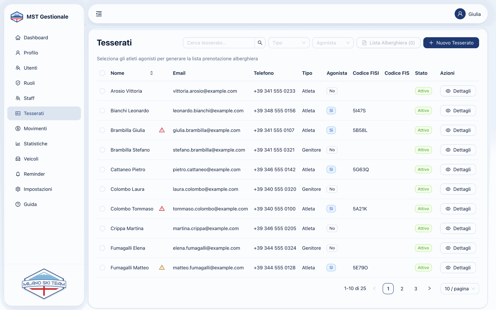
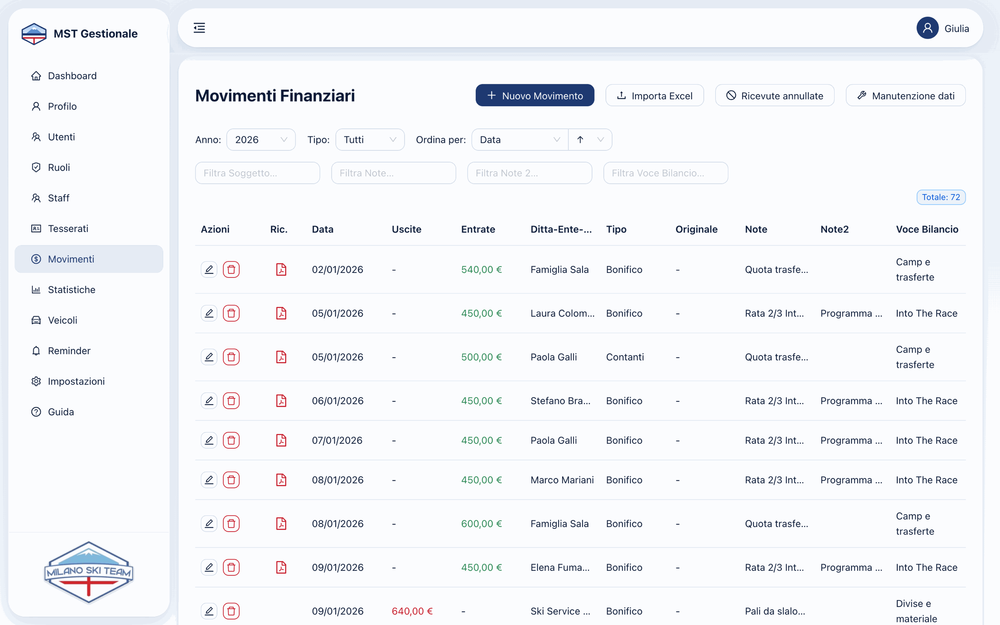
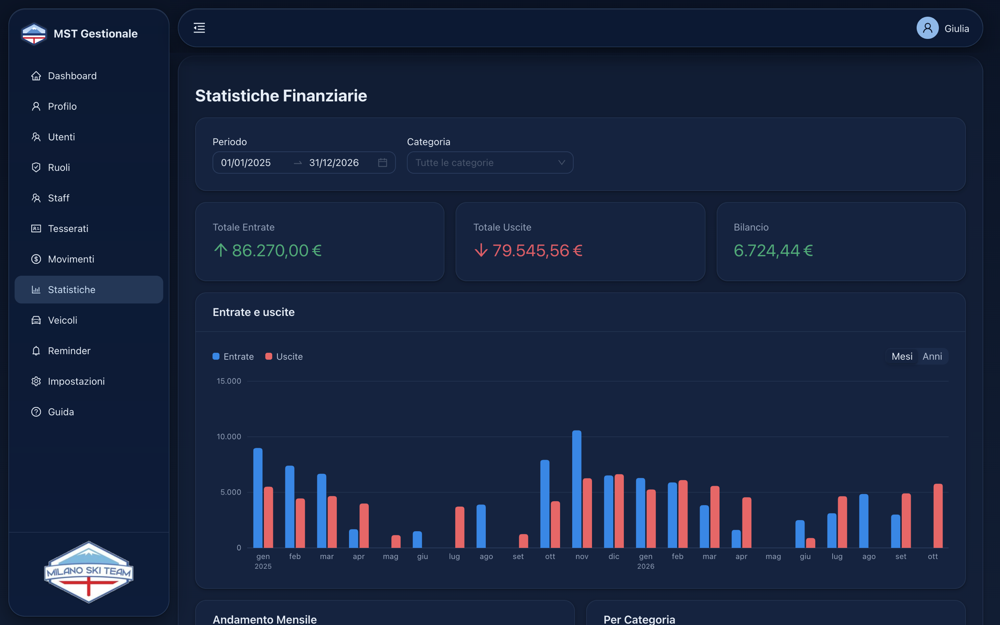
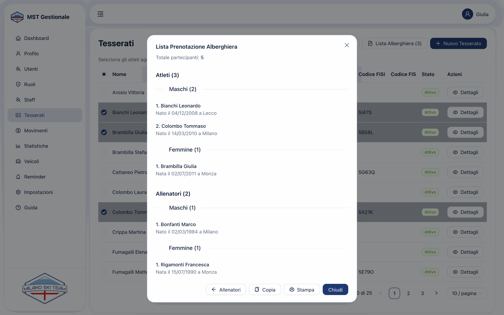
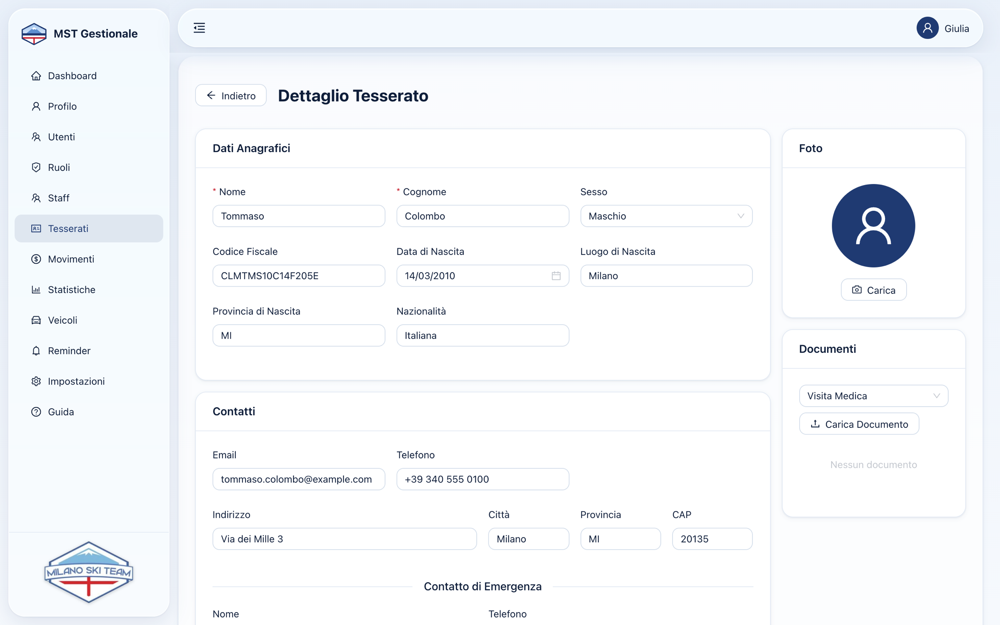
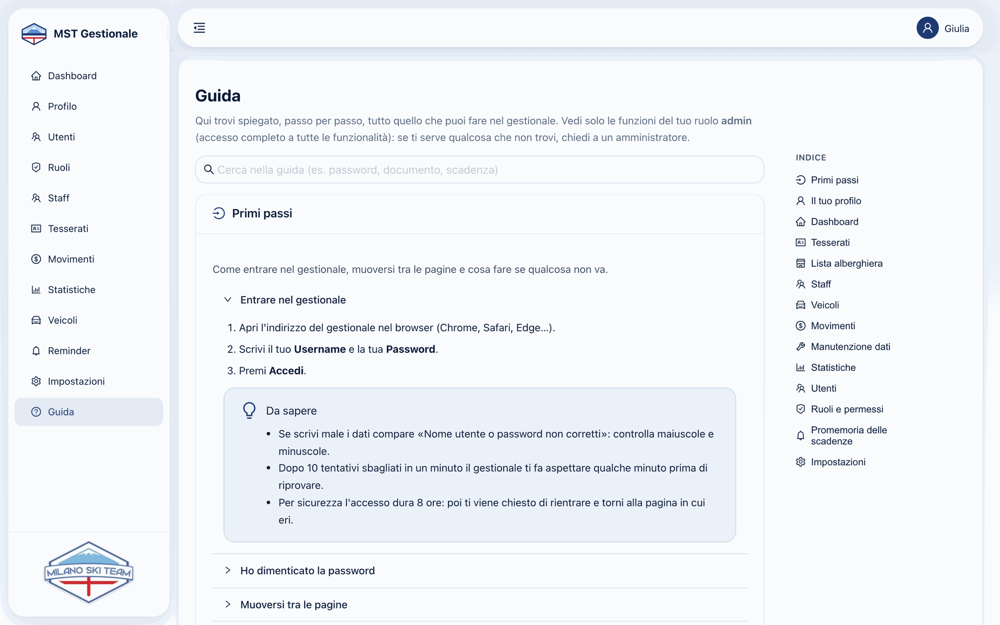
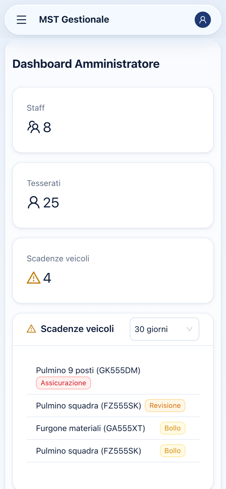
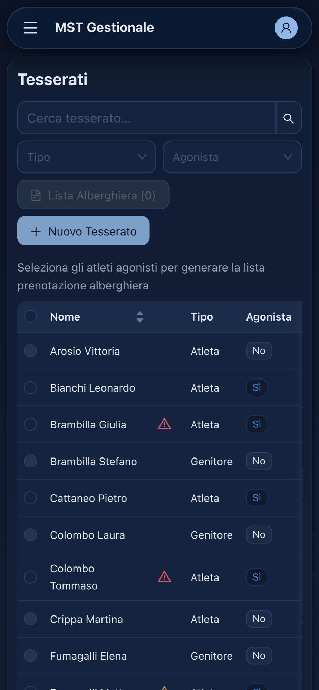
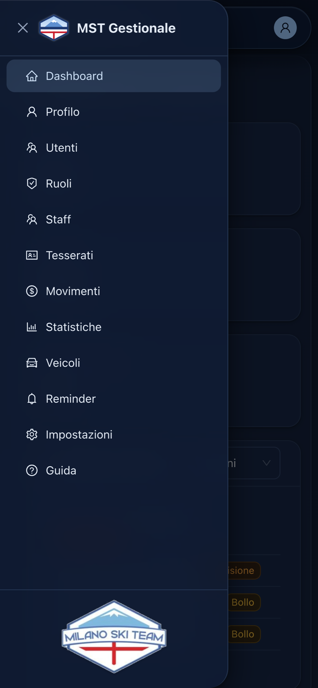

<div align="center">


# MST Gestionale

**Il gestionale web di uno sci club:** atleti e staff, prima nota con ricevute PDF, pulmini e scadenze, promemoria
automatici, statistiche e backup. Progettato per chi non è un tecnico, su computer e telefono.


Backend: [`mst-gestionale-be`](https://github.com/davideorsini94/mst-gestionale-be) · Versione **1.4**


<sub>Tutti gli screenshot usano dati di esempio inventati.</sub>

</div>

---

## Il progetto

Uno sci club deve tenere sotto controllo molte cose insieme: tesserati e visite mediche, patentini degli allenatori,
scadenze dei pulmini, entrate, uscite e ricevute. MST Gestionale, sviluppato per Milano Ski Team, riunisce tutto in
un'unica app web pensata per amministratori, allenatori e collaboratori, con **permessi per ruolo**: ognuno vede e
può fare solo quello che gli compete.

Questo repository contiene l'interfaccia: una single-page application React 19 + TypeScript, servita da nginx e
installabile come app sul telefono. Dati, ricevute, cifratura e promemoria sono nel
[backend NestJS](https://github.com/davideorsini94/mst-gestionale-be).

## Funzionalità

| | |
|---|---|
| **Tesserati e staff** | anagrafiche, codici FISI/FIS, visite mediche, patentini e qualifiche con scadenze evidenziate, foto con ritaglio, documenti allegati |
| **Lista alberghiera** | dagli atleti selezionati (e dagli allenatori scelti) genera l'elenco per l'albergo, diviso tra atleti e allenatori e per sesso, da copiare o stampare |
| **Movimenti** | prima nota con filtri e ordinamenti, ricevuta PDF per ogni entrata, archivio delle ricevute annullate, import da Excel/CSV con esito riga per riga |
| **Manutenzione dati** | pulizia dei duplicati degli import storici e revisione guidata degli importi, con annullamento |
| **Statistiche** | entrate, uscite e bilancio per periodo e categoria, grafico interattivo per mesi o anni |
| **Veicoli** | parco mezzi con scadenze di assicurazione, revisione e bollo, assegnazione allo staff |
| **Promemoria** | stato delle email automatiche di scadenza, reinvio e controllo immediato |
| **Utenti e ruoli** | account, ruoli personalizzati e 19 permessi assegnabili |
| **Impostazioni** | server email con invio di prova, backup e ripristino di dati e file |
| **Guida in linea** | spiegazioni passo passo filtrate sul ruolo di chi legge, con ricerca |

<table>
  <tr>
    <td width="50%"></td>
    <td width="50%"></td>
  </tr>
  <tr>
    <td align="center"><sub>Tesserati con le visite mediche in scadenza</sub></td>
    <td align="center"><sub>Prima nota con ricevute PDF</sub></td>
  </tr>
  <tr>
    <td></td>
    <td></td>
  </tr>
  <tr>
    <td align="center"><sub>Statistiche, tema scuro</sub></td>
    <td align="center"><sub>Lista alberghiera con atleti e allenatori</sub></td>
  </tr>
  <tr>
    <td></td>
    <td></td>
  </tr>
  <tr>
    <td align="center"><sub>Scheda del tesserato</sub></td>
    <td align="center"><sub>Guida in linea filtrata per ruolo</sub></td>
  </tr>
</table>

<p align="center">
  
  
  
</p>

## Scelte di progetto

### Pensato per chi non è un tecnico
- **Linguaggio semplice** e messaggi d'errore in italiano mostrati così come arrivano dal server ("Esiste già un
  tesserato con questo codice fiscale"), mai codici tecnici.
- **Importi all'italiana**: `1.234,56`, `1.000` e `12,5` vengono interpretati correttamente, anche incollando
  `1,000.50`; calendari e mesi in italiano.
- **Conferme solo dove servono**, con il focus su "Annulla" per le operazioni irreversibili.
- **Errori recuperabili**: liste e pagine che non si caricano mostrano "Riprova" invece di sembrare vuote; dopo una
  sessione scaduta si torna alla pagina in cui si era.
- **Guida in linea per ruolo**: un utente in sola lettura non legge istruzioni su pulsanti che non vedrà mai.

### Design ispirato ad Apple
- Materiali in vetro (`backdrop-filter`) per barre e menu, raggi concentrici, tipografia di sistema.
- **Tema chiaro, scuro o automatico** e opzione **Riduci trasparenza**, salvati sull'account e quindi uguali su
  tutti i dispositivi; rispetto di `prefers-reduced-motion` e `prefers-reduced-transparency`.
- Grafico delle statistiche in SVG scritto a mano, con tooltip, navigazione da tastiera e adattamento al tema.

### Mobile e PWA
- Layout responsive fino a 320 px: menu a scomparsa, filtri raccolti in un pannello, colonne secondarie nascoste.
- Installabile come app (manifest e icone maskable), service worker con cache legata alla versione della build:
  ogni rilascio viene caricato al primo cambio di pagina, senza file vecchi in cache.

### Sicurezza lato client
- **Rotte protette per permesso** (403 dentro il layout, 404 per pagine e schede inesistenti) e permessi
  aggiornati da `/auth/me` senza dover rientrare.
- **Nessun token negli URL**: PDF e documenti si aprono come blob scaricati con l'header `Authorization`; i backup
  con un link monouso rilasciato dal server.
- Escape di tutti i dati inseriti dagli utenti nelle pagine di stampa.
- Risposte vecchie ignorate (`useLatestRequest`): cambiando filtro in fretta non compaiono risultati della ricerca
  precedente.

## Stack

| Area | Tecnologie |
|---|---|
| UI | React 19, TypeScript, Ant Design 5, Tailwind CSS 4 |
| Routing e dati | React Router 7 (hash router), Axios, TanStack Query |
| Build | Vite (minificazione e id di build nel service worker) |
| Date | dayjs con localizzazione italiana |
| Immagini | `react-image-crop` per il ritaglio delle foto |
| Produzione | nginx (statici con cache immutabile, gzip, header di sicurezza, proxy di `/api`) |

```
src/
├── components/   layout con menu per permessi, pagine 403/404, ricerca, select ricercabili, ritaglio foto
├── helpers/      formattazione e lettura degli importi, messaggi d'errore, apertura sicura dei file
├── hooks/        utente corrente e permessi reattivi, scarto delle risposte superate
├── pages/        una cartella per area (Tesserati, Movimenti, Statistiche, Guida, …)
├── services/     client API con gestione della sessione, autenticazione
└── theme/        palette, token di AntD e variabili CSS per chiaro/scuro
```

## Avvio in locale

Requisiti: Node.js 20.15+ e il [backend](https://github.com/davideorsini94/mst-gestionale-be) in esecuzione.

```bash
npm install
echo "VITE_API_URL=http://localhost:3000/api" > .env
npm run dev          # http://localhost:5173
```

### Comandi

```bash
npm run dev       # sviluppo con ricarica automatica
npm run build     # build di produzione in dist/
npm run preview   # anteprima della build
npm run lint      # ESLint
```

## Produzione

La build (`dist/`) è servita da un container `nginx:alpine` che fa anche da proxy verso il backend: interfaccia e
API stanno sullo stesso indirizzo, quindi senza CORS. La configurazione in [`nginx.conf`](nginx.conf) imposta
`Cache-Control` immutabile per gli asset con hash, nessuna cache per `index.html`, `sw.js` e manifest, gzip, header
di sicurezza e upload fino a 1,1 GB per il ripristino dei backup.

```bash
npm run build
docker build -t mst-gestionale-ui .
```

## Autore

Progettato e sviluppato da **Davide Orsini** per Milano Ski Team.
